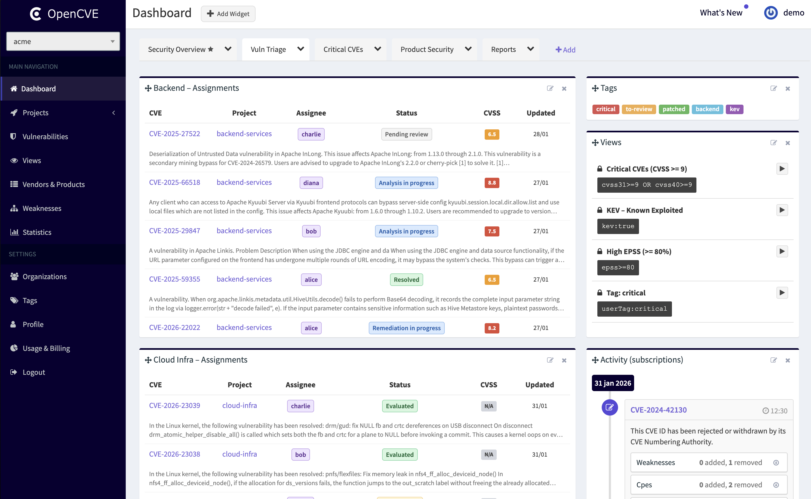
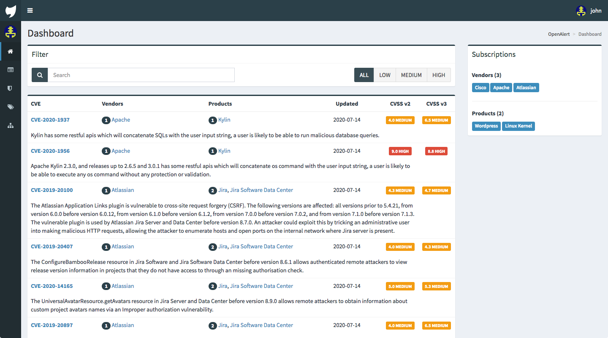
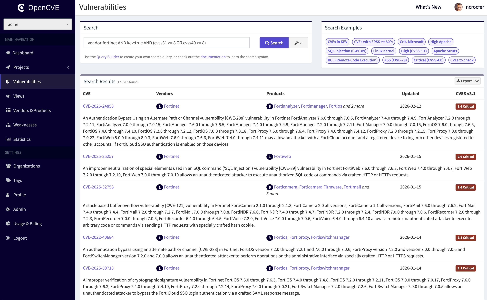
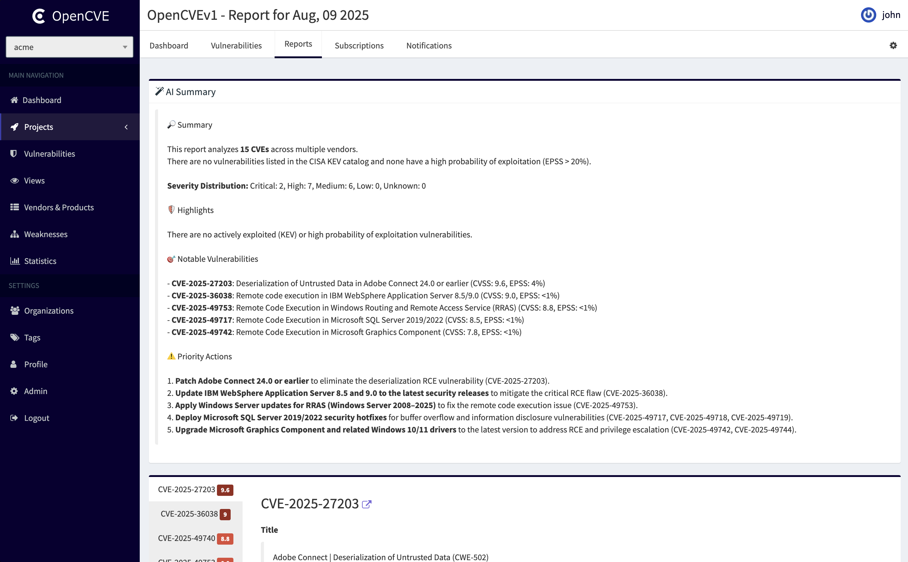
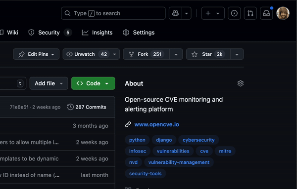

  

  
  
  

## What is OpenCVE?

OpenCVE is a Vulnerability Intelligence Platform that helps you monitor and manage CVEs efficiently.

It aggregates vulnerabilities from multiple sources (MITRE, NVD, RedHat, Vulnrichment...) and lets you filter, track, and organize them by vendor, product, severity, and more.

You can subscribe to products, receive alerts, analyze changes, and collaborate with your team — all through a simple and powerful interface. Assign members to CVEs to track progress (e.g. under analysis, risk accepted) and keep everyone aligned.

   

## Key Features

### 📚 Explore, Filter and Organize

- Filter CVEs by vendor, product, CVSS, KEV, EPSS, CWE, publication date, and more.
- Subscribe to vendors and products, and organize your monitoring with projects and organizations.
- Save complex filters as reusable Views.

### 🔖 Tag, Prioritize and Get Notified

- Classify CVEs with custom tags (e.g. unread, critical, assigned-to-dev).
- Assign users and statuses to CVEs to track progress (under analysis, risk accepted, etc.).
- Receive alerts instantly via email or webhook (Slack and Teams coming soon).

### 🔁 Track Changes and Generate Reports

- Access the complete change history of CVEs: scores, descriptions, references, etc.
- Generate daily reports by project to stay ahead.
- Get AI-powered report summaries to see priorities and immediate actions at a glance.

### 📊 Customize Your Dashboard

- Create multiple dashboards to organize your work the way you want.
- Build your own dashboard with widgets like "CVEs per project" or "Recent Reports".
- Drag, resize, and save layouts per organization.

### ✨ OpenCVE Enrichment

- Automatically associate CVEs with vendors, products, and affected versions.
- Advanced AI-powered analysis, including impact assessment and remediation insights, is available in OpenCVE Cloud.

## OpenCVE Community vs OpenCVE Cloud

OpenCVE is available as both a self-hosted Community edition and a hosted Cloud platform.

The Community edition allows you to track CVEs, organize your monitoring, and build your own workflows.

For teams that need more advanced capabilities, OpenCVE Cloud provides additional features such as:

- AI-powered CVE analysis and remediation insights
- Enterprise-grade security (SAML SSO, MFA enforcement)
- Managed, scalable infrastructure
- Advanced audit, SIEM & threat intelligence (coming soon)

👉 Learn more: [https://www.opencve.io/pricing](https://www.opencve.io/pricing)

## How to Use OpenCVE

### ✅ SaaS (Recommended)

Use the hosted version at [https://www.opencve.io](https://www.opencve.io) — no setup required, with access to advanced features and enterprise capabilities.

### 🐳 Self-Hosted

Run OpenCVE on your own infrastructure using Docker. See the [installation guide](https://docs.opencve.io/deployment/) for more details.

## Screenshots

  
  
  
  

## Contributing

We warmly welcome contributions to OpenCVE!

We have recently received a substantial number of contributions, potentially in part due to AI coding tools. Every PR still needs human review and ongoing maintenance, and our capacity is limited.

**Before starting work, please personally read our [Contributing Guidelines](CONTRIBUTING.md), whether you use AI tools or not.**

For features and significant behavior changes, discuss the need and proposed approach with the maintainers and wait for explicit agreement before implementation. An existing issue does not mean that a solution has been approved or prioritized.

Small, focused bug fixes and documentation corrections are welcome without prior discussion in most cases. Please coordinate before opening multiple unrelated PRs.

AI-assisted contributions are welcome, provided you understand, verify and take responsibility for your changes. Review and merge are subject to project priorities and maintainer availability.

## Stay Updated

OpenCVE is actively developed and regularly improved.

⭐ Star this repository and 🔔 watch releases to be notified of future updates.

   

## License

OpenCVE Community is released under a Business Source License (BSL), allowing free usage with some limitations for commercial use.

See the [LICENSE](LICENSE) file for more details.
